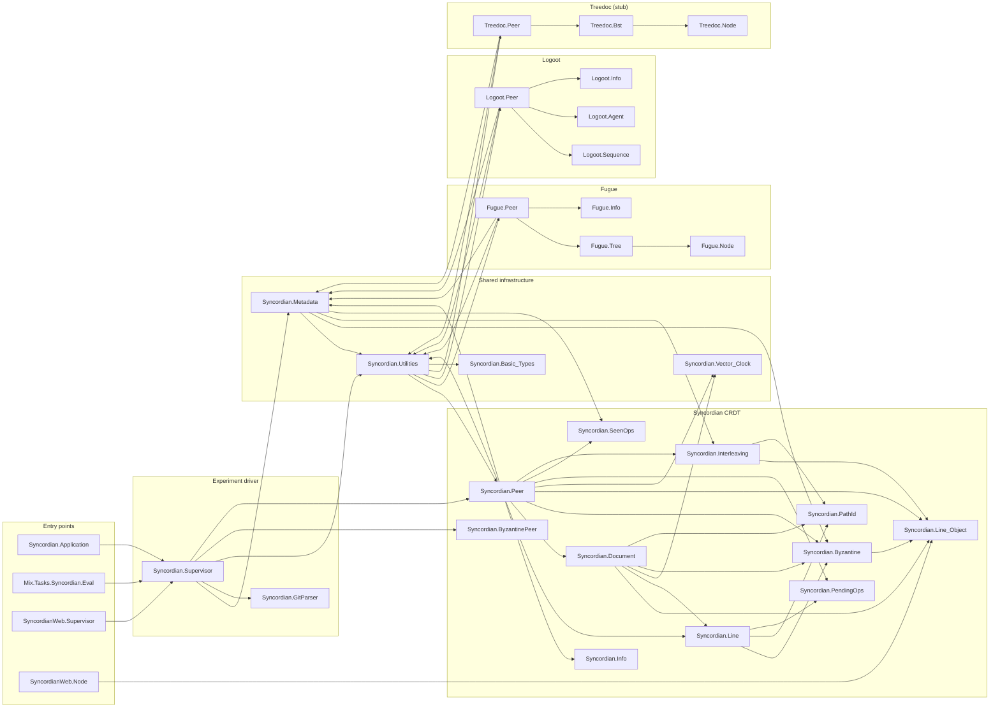

# Syncordian

Collaborative editing, as observed in projects such as Google Docs, often relies on costly
central services. While many CRDT exists to solve this problem, to date none have
mechanisms to support Byzantine faults and the presence of interleavings. We present the
Syncordian CRDT, which guarantees strong eventual consistency and intention preservation
between nodes as a consequence of the Byzantine faults-free algorithm implemented for
insertions, deletions, and update operations in share documents. Our scheme withstands
Byzantine nodes, providing immunity against Sybil attacks and ensuring strong eventual
consistency. Moreover, the presented algorithm naturally avoids interleavings when
synchronizing nodes. To evaluate Syncordian we use collaborative editing document taken
from github with over 700 concurrent edit operations contributed by 30 network peers. With
this evaluation we validate Syncordian is effective in maintaining document consistency
across all peers, even in the presence of Byzantine nodes. Moreover, we evaluate the
performance of the Syncordian with respect to memory consumption, network load, and
execution, demonstrating its usability in real world scenarios.

## Prerequisites

The project pins Elixir `~> 1.18.3` in `mix.exs`. The verified, working
toolchain is:

- **Erlang/OTP 28** (e.g. `28.5`)
- **Elixir 1.18.4** (built for OTP 28, i.e. `1.18.4-otp-28`)

>
> A newer default Elixir (e.g. 1.19.x) does **not** satisfy the `~> 1.18.3`
> constraint and `mix` will refuse to compile. If your machine defaults to a
> newer version (or you manage versions with `asdf`/`mise`), switch your
> default rather than prefixing every command, e.g.:
>
> ```bash
> asdf local elixir 1.18.4-otp-28 erlang 28.5
> # or: mise use elixir@1.18.4-otp-28 erlang@28.5
> ```
>
> Check what you have with `elixir --version`. There is no `.tool-versions` file
> in the repo, so the version is governed solely by the `mix.exs` constraint.
> The commands throughout this README assume `elixir`/`mix` on `PATH` already
> resolve to the pinned toolchain.

All Elixir dependencies are vendored in `deps/` and pre-compiled in `_build/`,
and the esbuild/tailwind binaries are cached under `_build/`, so the project
builds and runs **fully offline** — no `mix deps.get` or network access required.

## Installation & setup

```bash
git clone git@github.com:Masanar/Syncordian.git
cd Syncordian/code

# First time only: fetch deps and build the JS/CSS assets.
mix setup            # = deps.get + assets.setup + assets.build

# The experiment scripts write here; create it once.
mkdir -p debug/documents
```

## Running the web UI

There is no separate compile step — `mix phx.server` builds and serves the app:

```bash
mix phx.server                 # or: iex -S mix phx.server
```

Then open <http://localhost:4000>. The dev endpoint binds loopback only
(`127.0.0.1:4000`); to expose it on your LAN, set the endpoint IP to `{0,0,0,0}`
in `config/dev.exs`.

### LiveView pages

| Route         | Module                     | What it does |
| ------------- | -------------------------- | ------------ |
| `/`           | `SyncordianWeb.About`      | Static about page. |
| `/supervisor` | `SyncordianWeb.Supervisor` | **Experiment control panel** — pick a CRDT and Byzantine node count, launch the network, replay commits, dump documents, collect metadata. |
| `/node`       | `SyncordianWeb.Node`       | Raw document dump (including tombstones/sentinels) for a single peer. |
| `/readmelog`  | `SyncordianWeb.ReadmeLog`  | Visual view of the test git-commit log that drives the experiment. |

In development, `/dev/dashboard` (Phoenix LiveDashboard) and `/dev/mailbox`
(Swoosh mailbox preview) are also mounted.

## Driving an experiment

### From the UI (`/supervisor`)

1. Open <http://localhost:4000/supervisor>.
2. Pick a CRDT module (`:syncordian`, `:fugue`, `:logoot`; `:treedoc` is an
   incomplete stub) and a Byzantine node count.
3. **Launch** — spawns one peer per author in the test git log (30 author peers
   from the Oh My Zsh README history) plus the chosen number of Byzantine peers,
   all registered via `:global`.
4. **Next commit** / **All commits** — replays commits one at a time or in a loop.
5. **Write current peers document** — dumps every peer's materialized document to
   `debug/documents/<crdt>/document_peer_N` (or `tree_peer_N` for Fugue).

### Headless (no browser)

The same evaluation can be driven from scripts with `mix run --no-start`
(`--no-start` avoids booting the Phoenix/esbuild app, which is unnecessary and
crashes a script run). Each script under `code/scripts/` exercises a different
slice of the experiment:

- **`run_full_experiment.exs`** — the full paper experiment. Replays all 71
  commits of the OhMyZsh README git log across the 30 author peers (plus an
  optional number of Byzantine peers), waits for the network to settle, dumps
  every peer's document, and then checks byte-for-byte convergence inline.
  Wall time is ~3 min for the 71-commit replay.

  ```bash
  mix run --no-start scripts/run_full_experiment.exs           # 0 byzantine
  mix run --no-start scripts/run_full_experiment.exs 5         # 5 byzantine
  ```

- **`three_peer_smoke.exs`** — a fast, git-log-free smoke test. Spawns 3 peers,
  issues a handful of manual inserts and one delete, settles, and dumps each
  peer's document so you can diff peer 0 against peers 1 and 2. Useful as a
  quick sanity check after touching the core CRDT (PathId, vector clocks) without
  waiting for a full replay.

  ```bash
  mix run scripts/three_peer_smoke.exs
  ```

- **`interleaving_smoke.exs`** — targets the non-interleaving theorem
  specifically. Forces two peers to author overlapping edit blocks concurrently
  into the same interval (widening the broadcast delay so neither sees the
  other until both blocks are fully authored), then asserts both that the
  network converges and that each author's block stays contiguous (no
  interleaved lines).

  ```bash
  mix run --no-start scripts/interleaving_smoke.exs
  ```

- **`verify_convergence.exs`** — the canonical post-hoc check, meant to run
  after "Write current peers document" (from the UI or from
  `run_full_experiment.exs`). Unlike `identical.sh`, it derives the expected
  final document dynamically from the same live git source the experiment
  replayed (`Syncordian.GitLog` / `Syncordian.GitParser`), so it stays correct
  regardless of which clone or tracked file the run used. It checks, in order:
  (1) all peer documents are byte-identical to each other; (2) the converged
  document is byte-identical to the tracked file at the last replayed mainline
  commit (`git show <commit>:<file>`); (3) if a raw dump exists, no line is
  still `:aura` (i.e. every line settled to a final status at quiescence).

  ```bash
  mix run --no-start scripts/verify_convergence.exs
  ```

- Mix task entry point (drives `Syncordian.Supervisor.init/2` directly):

  ```bash
  mix syncordian.eval
  ```

Two small shell helpers round out the `scripts/` directory but aren't part of
the CRDT evaluation itself — they inspect the git history that drives the
replay: `analyze-commits.sh` lists the most frequently touched files across the
whole log, and `number-of-commits.sh <file_path>` counts commits touching a
given path.

### Checking convergence

`verify_convergence.exs` (above) is the preferred, dynamic check. The older
`scripts/identical.sh` remains for a simpler, fixture-free pairwise byte-equality
check across whatever's under `debug/documents/`:

```bash
cd code
scripts/identical.sh
```

## Visualizing results

The plotting scripts need Python with `matplotlib` (and `numpy`):

```bash
pip install -r scripts/requirements.txt          # add --break-system-packages on
                                                 # PEP 668 / Debian-managed Python
python3 scripts/data_visualization.py            # metrics vs commit / byzantine count
python3 scripts/heap_size_visualization.py       # writes figures/heap_size_plot.pdf
```

`data_visualization.py` reads JSON from `debug/metadata/`; `heap_size_visualization.py`
reads per-edit heap sizes from `debug/metadata/individual_peer/` and writes a PDF
to `figures/`.

## Testing

```bash
mix test                                   # all tests
mix test test/syncordian/path_id_test.exs  # a single file
mix test test/syncordian/path_id_test.exs:42  # a single test by line
```

`code/test/` is organized by what it exercises:

- **`test/syncordian/`** — unit tests for the Syncordian CRDT's internals, one
  file per concern: `path_id_test.exs` (dense identifier allocation between two
  existing lines), `document_test.exs` (line insertion/deletion bookkeeping),
  `interleaving_test.exs` (the re-placement logic that keeps concurrently
  authored blocks contiguous), `vector_clock_test.exs` (causal ordering),
  `pending_ops_test.exs` / `seen_ops_test.exs` (the buffers that hold
  out-of-order/duplicate remote edits until they're applicable), and
  `ack_signature_test.exs` / `wire_signature_test.exs` /
  `boundary_secret_test.exs` (the Byzantine-resistant signing scheme edits carry
  over the wire). A `supervisor/` subdirectory covers the commit-replay/edit-index
  accounting done by `Syncordian.Supervisor` and `Syncordian.GitParser`.
- **`test/syncordian_web/controllers/`** — Phoenix controller/endpoint tests for
  the LiveView routes.
- **`test/git_log/`** — legacy fixture git logs
  (`ohmyzsh_README_git_log`, `ohmyzsh_README_full_git_log`) kept for ad-hoc
  parser testing via `parser_git_log/1`; real experiment runs now read the log
  live from the configured clone through `Syncordian.GitLog` instead of these
  fixtures.

Code is formatted with `mix format` (config in `.formatter.exs`).

## API documentation

Browsable HTML docs are generated with [ExDoc](https://hexdocs.pm/ex_doc):

```bash
mix docs           # regenerates the site under doc/
```

Open `doc/index.html` in a browser — the site is self-contained and works
offline. Modules are grouped by sub-system (Syncordian core, Fugue, Logoot,
Treedoc, shared infrastructure, experiment driver, web).

## Architecture & module dependencies

The four CRDT peer modules (`Syncordian.Peer`, `Syncordian.CRDT.Fugue.Peer`,
`Syncordian.CRDT.Logoot.Peer`, `Syncordian.CRDT.Treedoc.Peer`) share the same
callable contract so `Syncordian.Supervisor` can drive them polymorphically:

```text
start(peer_id, network_size) :: pid
insert(pid, content, index, test_index, global_position, current_delete_ops)
delete_line(pid, index, test_index, global_position, current_delete_ops)
save_content(pid)
get_module_name() :: String.t()
```

Project layout:

- `lib/syncordian/` — CRDT backend and the experiment driver.
  - `CRDT/syncordian/` — the Syncordian CRDT (peer, document, line, path id,
    Byzantine signatures, interleaving handling, pending/seen-op buffers).
  - `CRDT/fugue/`, `CRDT/logoot/`, `CRDT/treedoc/` — the comparison CRDTs.
  - `CRDT/{utilities,metadata,vector_clock,types}.ex` — shared infrastructure.
  - `supervisor/` — `Syncordian.Supervisor` (hand-rolled receive loop) and the
    `Syncordian.GitParser` that turns commit logs into edits.
- `lib/syncordian_web/` — Phoenix LiveView UI.
- `scripts/` — convergence (`identical.sh`), headless experiments (`*.exs`), and
  the Python plotting scripts.

### Module dependency graph

A directed edge `A → B` means *module A depends on module B*. A rendered version
(`docs/dependency_graph.svg` / `.png`, regenerate with
`dot -Tsvg docs/dependency_graph.dot -o docs/dependency_graph.svg`) shows the same
graph grouped by sub-system. Note the intentional `Peer ↔ Utilities` cycle:
`Utilities` is both a helper library and the CRDT-agnostic dispatcher that routes
to every peer implementation.



## Credits

- Mateo Sanabria Ardila (m.sanabriaa_at_uniandes_dot_edu_dot_co)
- Nicolás Cardozo (n.cardozo_at_uniandes_dot_edu_co)

## License

The MIT License (MIT)

Copyright (c) Mateo Sanabria Ardila, Nicolás Cardozo

Permission is hereby granted, free of charge, to any person obtaining a copy of this
software and associated documentation files (the "Software"), to deal in the Software
without restriction, including without limitation the rights to use, copy, modify, merge,
publish, distribute, sublicense, and/or sell copies of the Software, and to permit persons
to whom the Software is furnished to do so, subject to the following conditions:

The above copyright notice and this permission notice shall be included in all copies or
substantial portions of the Software.

THE SOFTWARE IS PROVIDED "AS IS", WITHOUT WARRANTY OF ANY KIND, EXPRESS OR IMPLIED,
INCLUDING BUT NOT LIMITED TO THE WARRANTIES OF MERCHANTABILITY, FITNESS FOR A PARTICULAR
PURPOSE AND NONINFRINGEMENT. IN NO EVENT SHALL THE AUTHORS OR COPYRIGHT HOLDERS BE LIABLE
FOR ANY CLAIM, DAMAGES OR OTHER LIABILITY, WHETHER IN AN ACTION OF CONTRACT, TORT OR
OTHERWISE, ARISING FROM, OUT OF OR IN CONNECTION WITH THE SOFTWARE OR THE USE OR OTHER
DEALINGS IN THE SOFTWARE.
