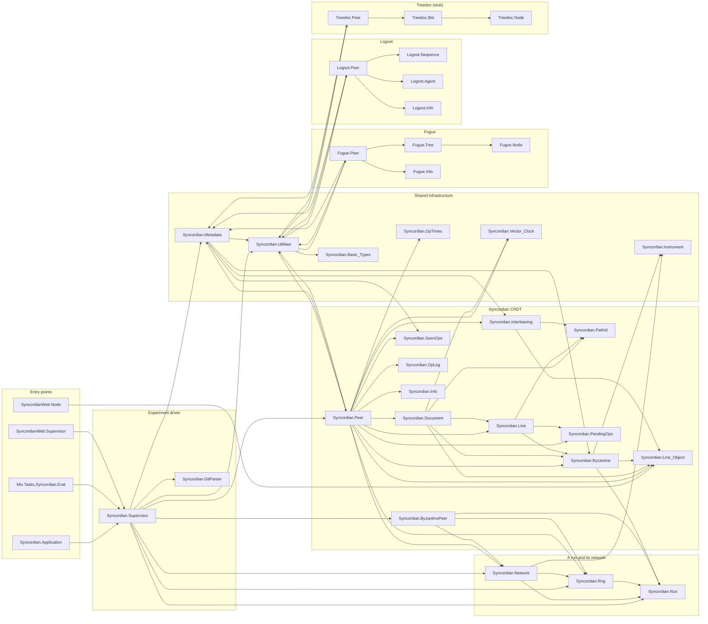

# Syncordian

Collaborative editing, as observed in projects such as Google Docs, often relies on costly
central services. While many CRDT exists to solve this problem, to date none have
mechanisms to support Byzantine faults and the presence of interleavings. We present the
Syncordian CRDT, which guarantees strong eventual consistency and intention preservation
between nodes as a consequence of the Byzantine faults-free algorithm implemented for
insertions, deletions, and update operations in share documents. Our scheme withstands
Byzantine nodes, providing immunity against Sybil attacks and ensuring strong eventual
consistency. Moreover, the presented algorithm naturally avoids interleavings when
synchronizing nodes. To evaluate Syncordian we use collaborative editing document taken
from github with over 700 concurrent edit operations contributed by 30 network peers. With
this evaluation we validate Syncordian is effective in maintaining document consistency
across all peers, even in the presence of Byzantine nodes. Moreover, we evaluate the
performance of the Syncordian with respect to memory consumption, network load, and
execution, demonstrating its usability in real world scenarios.

## Prerequisites

The project pins Elixir `~> 1.18.3` in `mix.exs`. The verified, working
toolchain is:

- **Erlang/OTP 28** (e.g. `28.5`)
- **Elixir 1.18.4** (built for OTP 28, i.e. `1.18.4-otp-28`)

>
> A newer default Elixir (e.g. 1.19.x) does **not** satisfy the `~> 1.18.3`
> constraint and `mix` will refuse to compile. If your machine defaults to a
> newer version (or you manage versions with `asdf`/`mise`), switch your
> default rather than prefixing every command, e.g.:
>
> ```bash
> asdf local elixir 1.18.4-otp-28 erlang 28.5
> # or: mise use elixir@1.18.4-otp-28 erlang@28.5
> ```
>
> Check what you have with `elixir --version`. There is no `.tool-versions` file
> in the repo, so the version is governed solely by the `mix.exs` constraint.
> The commands throughout this README assume `elixir`/`mix` on `PATH` already
> resolve to the pinned toolchain.

All Elixir dependencies are vendored in `deps/` and pre-compiled in `_build/`,
and the esbuild/tailwind binaries are cached under `_build/`, so the project
builds and runs **fully offline** — no `mix deps.get` or network access required.

## Installation & setup

```bash
git clone git@github.com:Masanar/Syncordian.git
cd Syncordian/code

# First time only: fetch deps and build the JS/CSS assets.
mix setup            # = deps.get + assets.setup + assets.build

# The experiment scripts write here; create it once.
mkdir -p debug/documents
```

## What a run is

Everything below produces or checks a **run**. A run is one execution of the
system under one setting. A run is described by four things.

| Part | What it means | Default |
| ---- | ------------- | ------- |
| **seed** | One number that fixes every random choice the system makes. Two runs with the same seed do the same thing. | none, so the run cannot be repeated |
| **delay** | How long each message waits before it arrives. Written as `uniform:5:50`, meaning every message waits a random time between 5 and 50 milliseconds. | `none`, no delay at all |
| **scenario** | What goes wrong during the run. One of `baseline`, `reorder_storm`, `offline_window`, `post_collection_replay`, `bounded_loss`. The last four are explained under Live tests. | `baseline`, nothing goes wrong |
| **adversaries** | How many distrusted nodes join the network and attack it. | `0` |

A run writes everything it did into one folder. That folder holds:

- `manifest.json`, the four things above plus the machine and the versions used.
  If you want to know how a number was produced, read this file.
- `documents/`, the final document of every peer.
- `metadata/`, counters taken during the run.
- `result.json`, whether the run converged and how long it took.

The default folder is `debug/`. You can point a run somewhere else with `--out`.

The seed matters more than it looks. With a seed, two runs produce the same
document, the same identifiers, and the same signatures. Without one, they do
not. The seed does not control the order in which Erlang schedules the peers, and
nothing can, so the timing of a run still varies. That is why results are
reported over many runs instead of one.

## Testing

There are two kinds of test. Both are ordinary ExUnit tests, run with `mix test`.

### Fast tests

These do not start peers and do not need a git clone. They take about ten
seconds.

```bash
mix test                                       # every fast test
mix test test/syncordian/path_id_test.exs      # one file
mix test test/syncordian/path_id_test.exs:42   # one test, by line number
```

| File | What it checks |
| ---- | -------------- |
| `path_id_test.exs` | Picking a position identifier between two existing lines. |
| `document_test.exs` | Inserting and deleting lines in a document. |
| `interleaving_test.exs` | The rule that keeps each author's block of lines together. |
| `reissue_alias_test.exs` | What happens when a line is moved and deleted at the same time. |
| `vector_clock_test.exs` | Deciding which edit happened before which. |
| `progress_semantics_test.exs` | When an edit is allowed to be applied. |
| `pending_ops_test.exs` | The buffer that holds an edit until the edit it depends on arrives. |
| `seen_ops_test.exs` | Remembering which edits were already applied, so a repeat is ignored. |
| `op_log_test.exs` | The log a peer keeps so it can send an edit again if someone lost it. |
| `wire_signature_test.exs` | The tags that travel with a message. |
| `ack_signature_test.exs` | The tags on acknowledgements. |
| `boundary_secret_test.exs` | The shared secret that decides who is allowed in. |
| `insider_scope_test.exs` | Writes down what the system does not protect against, on purpose. |
| `instrumentation_test.exs` | The counters that measure cost. |
| `run_config_test.exs` | **New.** Seeds, the delay setting, and the description of a run. |
| `network_test.exs` | **New.** The simulated network, and what an attacker can do to a message. |
| `supervisor/gitparser_test.exs` | Turning a git log into edits. |
| `supervisor/gitlog_test.exs` | Reading the git log from a real clone. |

### Live tests

These start real peer processes and let them talk to each other. They take about
fifty seconds, so they are skipped unless you ask for them.

```bash
mix test --include live          # the fast tests plus the live ones
```

| File | What it checks |
| ---- | -------------- |
| `live/recovery_test.exs` | A peer that missed an edit asks for it again and gets it. |
| `live/difficult_executions_test.exs` | **New.** The four hard situations below. |

The four hard situations are the interesting part, so here is what each one does.

| Situation | Name to pass to `--scenario` | What happens | What must still be true |
| --------- | ---------------------------- | ------------ | ----------------------- |
| **Reorder storm** | `reorder_storm` | Messages are delayed, sent twice, and mixed up, while an attacker sends fake ones. Almost nothing arrives in the order it was sent. | Every peer ends with the same document, no fake message is accepted, and no line is left unfinished. |
| **Offline window** | `offline_window` | One peer is cut off, misses edits, and is later reconnected. Nobody resends anything to it. | It asks for what it missed and catches up. |
| **Post-collection replay** | `post_collection_replay` | An attacker records real messages and sends them again much later, after the peers have stopped remembering them. These messages are genuine, so they pass every security check. | The document does not change. No line appears twice, and a deleted line does not come back. |
| **Bounded loss** | `bounded_loss` | Messages are thrown away at random on every link for a while, and then the network heals. | The peers ask for what was lost and end up with the same document. |

The third one is the important one. Those messages are real, so checking
signatures cannot stop them. What stops them is that every edit carries an
identity, and that a deleted line stays deleted.

### Smoke scripts

These are not ExUnit tests. They are small programs that set up one situation and
print `PASS` or `FAIL`. Use them for a quick check after changing the CRDT,
without waiting for a full replay.

```bash
mix run --no-start scripts/three_peer_smoke.exs    # three peers, a few edits
mix run --no-start scripts/interleaving_smoke.exs  # two peers writing at the same spot
mix run --no-start scripts/cascade_smoke.exs       # three peers, and a delete during a repair
```

Use `--no-start` so Mix does not boot the web app, which a script does not need.

Code is formatted with `mix format`.

## Running one experiment

An experiment replays a real git history. Each contributor becomes one peer, and
each commit becomes a set of edits. At the end, every peer's document must match
the file as git holds it.

```bash
mix run --no-start scripts/run_full_experiment.exs
```

Some useful options:

```bash
# A repeatable run under a real delay.
mix run --no-start scripts/run_full_experiment.exs --seed 1 --delay uniform:5:50

# Five distrusted nodes attacking during the replay.
mix run --no-start scripts/run_full_experiment.exs --seed 1 --delay uniform:5:50 --adversaries 5

# One of the hard situations, over the whole history.
mix run --no-start scripts/run_full_experiment.exs --seed 1 --delay uniform:5:50 \
  --scenario reorder_storm --adversaries 5

# Write somewhere other than debug/.
mix run --no-start scripts/run_full_experiment.exs --seed 1 --delay uniform:5:50 --out /tmp/run1
```

The script first prints the repository, the tracked file, the number of peers,
the number of commits, and the hash of the last commit. It then replays
everything, waits for the network to go quiet, and checks two things. First, that
all peers agree with each other. Second, that they agree with
`git show <hash>:<file>`. Agreement on its own is not enough, because peers that
all made the same mistake still agree with each other.

Add `--observer` to open the Erlang observer window and watch the peers while
they work. It needs a graphical display. If it cannot start, the run continues
without it.

To choose which repository and file to replay, set these before the command:

```bash
SYNCORDIAN_REPO_PATH=../../ohmyzsh \
SYNCORDIAN_TRACKED_FILE=README.md \
SYNCORDIAN_MAX_COMMITS=20 \
mix run --no-start scripts/run_full_experiment.exs --seed 1 --delay uniform:5:50
```

`SYNCORDIAN_MAX_COMMITS` is useful while trying things out, because a short
history finishes in seconds instead of minutes.

There is also a Mix task that does a simpler version of the same thing:

```bash
mix syncordian.eval --crdt syncordian --byzantine 0
```

And a separate checker you can run after any experiment:

```bash
mix run --no-start scripts/verify_convergence.exs
```

It checks that all peer documents are identical, that they match the file in git,
and that no line was left unfinished.

## Running many experiments

One run tells you very little. The timing of a concurrent system changes from run
to run, so a single number is one observation and not a property of the system.
Each setting is therefore run ten times, with ten different seeds, and reported as
an average with a confidence interval.

```bash
mix run --no-start scripts/run_repetitions.exs \
  --reps 10 --seed-base 1 --delay uniform:5:50 \
  --scenarios baseline,reorder_storm --adversaries 5 --root debug/runs
```

Each repetition runs as its own operating system process. This matters, because
two runs inside one Erlang node would share state, and then the runs would not be
independent.

The sweep can be stopped and started again. A repetition that already has a
`result.json` is skipped, so no work is repeated.

Two things the driver refuses to do, on purpose.

- It refuses `--delay none`. The paper says peers exchange messages under a
  delay, so a run whose numbers are reported has to apply one.
- It refuses `offline_window` and `bounded_loss` over a git history. In those two
  situations a peer can fall behind with nothing to tell it so, and the replay
  then waits for that peer forever instead of failing. Both are checked by the
  live tests instead. Pass `--allow-stalling-scenarios` to try anyway.

### Reading the numbers

```bash
pip install -r scripts/requirements.txt     # matplotlib and numpy

python3 scripts/aggregate_runs.py --runs debug/runs --out debug/aggregate
python3 scripts/data_visualization.py
python3 scripts/heap_size_visualization.py
```

`aggregate_runs.py` reads every run folder and writes one table,
`debug/aggregate/summary.csv`, plus the same data as JSON. Each row is one
measurement at one point, with the number of runs behind it, the average, the
spread, and a 95% confidence interval. Two rules keep those numbers honest.

- **One run is one sample.** Each run is reduced to a single value first, and the
  interval is taken over those ten values. Pouring every message of every run
  into one pile would give a much narrower interval, for a reason that has
  nothing to do with how repeatable the experiment is.
- **Some quantities cannot vary.** Under the same workload the number of edits,
  and the bytes they take, are the same every time. Those are marked and drawn
  without a band, because a band there would suggest a doubt that does not exist.

The two plotting scripts read that table and draw the average, the confidence
band, and the individual runs behind it. They write PDFs into `figures/`.

One note on `heap_size_visualization.py`. Only one peer records the size of its
document after every edit, so the plot needs a run with enough peers for that one
to exist. A short history with only three or four peers produces no data for it,
and the script says so instead of drawing an empty figure.

## Web UI (optional)

The web app is not needed for anything above. It is a control panel for running
an experiment by hand.

```bash
mix phx.server
```

Then open <http://localhost:4000>.

| Route | What it does |
| ----- | ------------ |
| `/` | About page. |
| `/supervisor` | Pick a CRDT and a number of distrusted nodes, launch the network, replay commits, dump documents. |
| `/node` | The raw document of one peer, including deleted lines. |
| `/readmelog` | The git commit log that drives the experiment. |

## Other helpers

`scripts/analyze-commits.sh` lists the files a repository changes most often, and
`scripts/number-of-commits.sh <path>` counts the commits touching one file. They
help you pick a history to replay. Neither is part of the evaluation.

`test/git_log/` holds two captured git logs. Some tests still read them. Real
runs read the log live from a clone instead.

## API documentation

Browsable HTML docs are generated with [ExDoc](https://hexdocs.pm/ex_doc):

```bash
mix docs           # regenerates the site under doc/
```

Open `doc/index.html` in a browser — the site is self-contained and works
offline. Modules are grouped by sub-system (Syncordian core, Fugue, Logoot,
Treedoc, shared infrastructure, experiment driver, web).

## Architecture & module dependencies

The four CRDT peer modules (`Syncordian.Peer`, `Syncordian.CRDT.Fugue.Peer`,
`Syncordian.CRDT.Logoot.Peer`, `Syncordian.CRDT.Treedoc.Peer`) share the same
callable contract so `Syncordian.Supervisor` can drive them polymorphically:

```text
start(peer_id, network_size) :: pid
insert(pid, content, index, test_index, global_position, current_delete_ops)
delete_line(pid, index, test_index, global_position, current_delete_ops)
save_content(pid)
get_module_name() :: String.t()
```

Project layout:

- `lib/syncordian/` — CRDT backend and the experiment driver.
  - `CRDT/syncordian/` — the Syncordian CRDT (peer, document, line, path id,
    signatures, interleaving handling, pending/seen-op buffers, origin log).
  - `CRDT/fugue/`, `CRDT/logoot/`, `CRDT/treedoc/` — the comparison CRDTs.
  - `CRDT/{utilities,metadata,vector_clock,instrument,op_times,types}.ex` —
    shared infrastructure and the cost measurements.
  - `run.ex`, `rng.ex`, `network.ex` — the description of a run, the randomness a
    seed fixes, and the simulated network every message crosses.
  - `supervisor/` — `Syncordian.Supervisor` (hand-rolled receive loop) and the
    `Syncordian.GitParser` that turns commit logs into edits.
- `lib/syncordian_web/` — Phoenix LiveView UI.
- `scripts/` — one run (`run_full_experiment.exs`), many runs
  (`run_repetitions.exs`), the post-hoc check (`verify_convergence.exs`), the
  smoke programs, and the Python aggregation and plotting.

### Module dependency graph

A directed edge `A → B` means *module A depends on module B*. A rendered version
(`docs/dependency_graph.svg` / `.png`, regenerate with
`dot -Tsvg docs/dependency_graph.dot -o docs/dependency_graph.svg`) shows the same
graph grouped by sub-system. Note the intentional `Peer ↔ Utilities` cycle:
`Utilities` is both a helper library and the CRDT-agnostic dispatcher that routes
to every peer implementation.



## Credits

- Mateo Sanabria Ardila (m.sanabriaa_at_uniandes_dot_edu_dot_co)
- Nicolás Cardozo (n.cardozo_at_uniandes_dot_edu_co)

## License

The MIT License (MIT)

Copyright (c) Mateo Sanabria Ardila, Nicolás Cardozo

Permission is hereby granted, free of charge, to any person obtaining a copy of this
software and associated documentation files (the "Software"), to deal in the Software
without restriction, including without limitation the rights to use, copy, modify, merge,
publish, distribute, sublicense, and/or sell copies of the Software, and to permit persons
to whom the Software is furnished to do so, subject to the following conditions:

The above copyright notice and this permission notice shall be included in all copies or
substantial portions of the Software.

THE SOFTWARE IS PROVIDED "AS IS", WITHOUT WARRANTY OF ANY KIND, EXPRESS OR IMPLIED,
INCLUDING BUT NOT LIMITED TO THE WARRANTIES OF MERCHANTABILITY, FITNESS FOR A PARTICULAR
PURPOSE AND NONINFRINGEMENT. IN NO EVENT SHALL THE AUTHORS OR COPYRIGHT HOLDERS BE LIABLE
FOR ANY CLAIM, DAMAGES OR OTHER LIABILITY, WHETHER IN AN ACTION OF CONTRACT, TORT OR
OTHERWISE, ARISING FROM, OUT OF OR IN CONNECTION WITH THE SOFTWARE OR THE USE OR OTHER
DEALINGS IN THE SOFTWARE.
