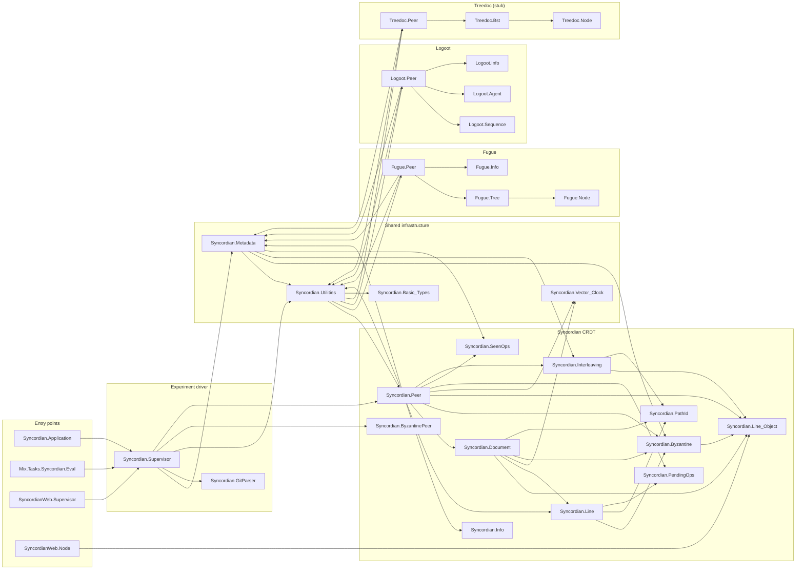

# Syncordian

Collaborative editing, as observed in projects such as Google Docs, often relies on costly
central services. While many CRDT exists to solve this problem, to date none have
mechanisms to support Byzantine faults and the presence of interleavings. We present the
Syncordian CRDT, which guarantees strong eventual consistency and intention preservation
between nodes as a consequence of the Byzantine faults-free algorithm implemented for
insertions, deletions, and update operations in share documents. Our scheme withstands
Byzantine nodes, providing immunity against Sybil attacks and ensuring strong eventual
consistency. Moreover, the presented algorithm naturally avoids interleavings when
synchronizing nodes. To evaluate Syncordian we use collaborative editing document taken
from github with over 700 concurrent edit operations contributed by 30 network peers. With
this evaluation we validate Syncordian is effective in maintaining document consistency
across all peers, even in the presence of Byzantine nodes. Moreover, we evaluate the
performance of the Syncordian with respect to memory consumption, network load, and
execution, demonstrating its usability in real world scenarios.

## Additional Results
### Interleaving evaluation results

The table below shows the results for the percentage of interleavings that occur while building the shared document for the Oh my zsh readme file. In the table we shows the average percentage of interleavings, together with the final document for each peer, and the number of interleavings in each file

| Implementation    | Average % of interleaving lines | peer 1 | peer 2 | peer 3 | peer 4 | peer 5 | peer 6 | peer 7 | peer 8 | peer 9 | peer 10 | peer 11 | peer 12 | peer 13 | peer 14 | peer 15 | peer 16 | peer 17 | peer 18 | peer 19 | peer 20 | peer 21 | peer 22 | peer 23 | peer 24 | peer 25 | peer 26 | peer 27 | peer 28 | peer 29 | peer 30 |
| -------- | :-------: | :-------: | :-------: | :-------: | :-------: | :-------: | :-------: | :-------: | :-------: | :-------: | :-------: | :-------: | :-------: | :-------: | :-------: | :-------: | :-------: | :-------: | :-------: | :-------: | :-------: | :-------: | :-------: | :-------: | :-------: | :-------: | :-------: | :-------: | :-------: | :-------: | :-------: 
| Logoot  | % | peer 1 | peer 2 | peer 3 | peer 4 | peer 5 | peer 6 | peer 7 | peer 8 | peer 9 | peer 10 | peer 11 | peer 12 | peer 13 | peer 14 | peer 15 | peer 16 | peer 17 | peer 18 | peer 19 | peer 20 | peer 21 | peer 22 | peer 23 | peer 24 | peer 25 | peer 26 | peer 27 | peer 28 | peer 29 | peer 30 |
| Treedoc | % | peer 1 | peer 2 | peer 3 | peer 4 | peer 5 | peer 6 | peer 7 | peer 8 | peer 9 | peer 10 | peer 11 | peer 12 | peer 13 | peer 14 | peer 15 | peer 16 | peer 17 | peer 18 | peer 19 | peer 20 | peer 21 | peer 22 | peer 23 | peer 24 | peer 25 | peer 26 | peer 27 | peer 28 | peer 29 | peer 30 |
| Fugue | 0% | [peer 1](https://github.com/Masanar/Syncordian/tree/main/debug/documents/fugue/tree_peer_1) <br> 0 interleavings | [peer 2](https://github.com/Masanar/Syncordian/tree/main/debug/documents/fugue/tree_peer_2) <br> 0 interleavings | [peer 3](https://github.com/Masanar/Syncordian/tree/main/debug/documents/fugue/tree_peer_3) <br> 0 interleavings | [peer 4](https://github.com/Masanar/Syncordian/tree/main/debug/documents/fugue/tree_peer_4) <br> 0 interleavings | [peer 5](https://github.com/Masanar/Syncordian/tree/main/debug/documents/fugue/tree_peer_5) <br> 0 interleavings | [peer 6](https://github.com/Masanar/Syncordian/tree/main/debug/documents/fugue/tree_peer_6) <br> 0 interleavings | [peer 7](https://github.com/Masanar/Syncordian/tree/main/debug/documents/fugue/tree_peer_7) <br> 0 interleavings | [peer 8](https://github.com/Masanar/Syncordian/tree/main/debug/documents/fugue/tree_peer_8) <br> 0 interleavings | [peer 9](https://github.com/Masanar/Syncordian/tree/main/debug/documents/fugue/tree_peer_9) <br> 0 interleavings | [peer 10](https://github.com/Masanar/Syncordian/tree/main/debug/documents/fugue/tree_peer_10) <br> 0 interleavings| [peer 11](https://github.com/Masanar/Syncordian/tree/main/debug/documents/fugue/tree_peer_11) <br> 0 interleavings | [peer 12](https://github.com/Masanar/Syncordian/tree/main/debug/documents/fugue/tree_peer_12) <br> 0 interleavings | [peer 13](https://github.com/Masanar/Syncordian/tree/main/debug/documents/fugue/tree_peer_13) <br> 0 interleavings | [peer 14](https://github.com/Masanar/Syncordian/tree/main/debug/documents/fugue/tree_peer_14) <br> 0 interleavings | [peer 15](https://github.com/Masanar/Syncordian/tree/main/debug/documents/fugue/tree_peer_15) <br> 0 interleavings | [peer 16](https://github.com/Masanar/Syncordian/tree/main/debug/documents/fugue/tree_peer_16) <br> 0 interleavings| peer [peer 17](https://github.com/Masanar/Syncordian/tree/main/debug/documents/fugue/tree_peer_17) <br> 0 interleavings | [peer 18](https://github.com/Masanar/Syncordian/tree/main/debug/documents/fugue/tree_peer_18) <br> 0 interleavings | [peer 19](https://github.com/Masanar/Syncordian/tree/main/debug/documents/fugue/tree_peer_19) <br> 0 interleavings | [peer 20](https://github.com/Masanar/Syncordian/tree/main/debug/documents/fugue/tree_peer_20) <br> 0 interleavings | [peer 21](https://github.com/Masanar/Syncordian/tree/main/debug/documents/fugue/tree_peer_21) <br> 0 interleavings | [peer 22](https://github.com/Masanar/Syncordian/tree/main/debug/documents/fugue/tree_peer_22) <br> 0 interleavings | [peer 23](https://github.com/Masanar/Syncordian/tree/main/debug/documents/fugue/tree_peer_23) <br> 0 interleavings | [peer 24](https://github.com/Masanar/Syncordian/tree/main/debug/documents/fugue/tree_peer_24) <br> 0 interleavings | [peer 25](https://github.com/Masanar/Syncordian/tree/main/debug/documents/fugue/tree_peer_25) <br> 0 interleavings | [peer 26](https://github.com/Masanar/Syncordian/tree/main/debug/documents/fugue/tree_peer_26) <br> 0 interleavings | [peer 27](https://github.com/Masanar/Syncordian/tree/main/debug/documents/fugue/tree_peer_27) <br> 0 interleavings | [peer 28](https://github.com/Masanar/Syncordian/tree/main/debug/documents/fugue/tree_peer_28) <br> 0 interleavings | [peer 29](https://github.com/Masanar/Syncordian/tree/main/debug/documents/fugue/tree_peer_29) <br> 0 interleavings | [peer 30](https://github.com/Masanar/Syncordian/tree/main/debug/documents/fugue/tree_peer_30) <br> 0 interleavings |
| Syncordian | 0% | [peer 1](https://github.com/Masanar/Syncordian/tree/main/debug/documents/syncordian/document_peer_1) <br> 0 interleavings | [peer 2](https://github.com/Masanar/Syncordian/tree/main/debug/documents/syncordian/document_peer_2) <br> 0 interleavings | [peer 3](https://github.com/Masanar/Syncordian/tree/main/debug/documents/syncordian/document_peer_3) <br> 0 interleavings | [peer 4](https://github.com/Masanar/Syncordian/tree/main/debug/documents/syncordian/document_peer_4) <br> 0 interleavings | [peer 5](https://github.com/Masanar/Syncordian/tree/main/debug/documents/syncordian/document_peer_5) <br> 0 interleavings | [peer 6](https://github.com/Masanar/Syncordian/tree/main/debug/documents/syncordian/document_peer_6) <br> 0 interleavings | [peer 7](https://github.com/Masanar/Syncordian/tree/main/debug/documents/syncordian/document_peer_7) <br> 0 interleavings | [peer 8](https://github.com/Masanar/Syncordian/tree/main/debug/documents/syncordian/document_peer_8) <br> 0 interleavings | [peer 9](https://github.com/Masanar/Syncordian/tree/main/debug/documents/syncordian/document_peer_9) <br> 0 interleavings | [peer 10](https://github.com/Masanar/Syncordian/tree/main/debug/documents/syncordian/document_peer_10) <br> 0 interleavings| [peer 11](https://github.com/Masanar/Syncordian/tree/main/debug/documents/syncordian/document_peer_11) <br> 0 interleavings | [peer 12](https://github.com/Masanar/Syncordian/tree/main/debug/documents/syncordian/document_peer_12) <br> 0 interleavings | [peer 13](https://github.com/Masanar/Syncordian/tree/main/debug/documents/syncordian/document_peer_13) <br> 0 interleavings | [peer 14](https://github.com/Masanar/Syncordian/tree/main/debug/documents/syncordian/document_peer_14) <br> 0 interleavings | [peer 15](https://github.com/Masanar/Syncordian/tree/main/debug/documents/syncordian/document_peer_15) <br> 0 interleavings | [peer 16](https://github.com/Masanar/Syncordian/tree/main/debug/documents/syncordian/document_peer_16) <br> 0 interleavings| peer [peer 17](https://github.com/Masanar/Syncordian/tree/main/debug/documents/syncordian/document_peer_17) <br> 0 interleavings | [peer 18](https://github.com/Masanar/Syncordian/tree/main/debug/documents/syncordian/document_peer_18) <br> 0 interleavings | [peer 19](https://github.com/Masanar/Syncordian/tree/main/debug/documents/syncordian/document_peer_19) <br> 0 interleavings | [peer 20](https://github.com/Masanar/Syncordian/tree/main/debug/documents/syncordian/document_peer_20) <br> 0 interleavings | [peer 21](https://github.com/Masanar/Syncordian/tree/main/debug/documents/syncordian/document_peer_21) <br> 0 interleavings | [peer 22](https://github.com/Masanar/Syncordian/tree/main/debug/documents/syncordian/document_peer_22) <br> 0 interleavings | [peer 23](https://github.com/Masanar/Syncordian/tree/main/debug/documents/syncordian/document_peer_23) <br> 0 interleavings | [peer 24](https://github.com/Masanar/Syncordian/tree/main/debug/documents/syncordian/document_peer_24) <br> 0 interleavings | [peer 25](https://github.com/Masanar/Syncordian/tree/main/debug/documents/syncordian/document_peer_25) <br> 0 interleavings | [peer 26](https://github.com/Masanar/Syncordian/tree/main/debug/documents/syncordian/document_peer_26) <br> 0 interleavings | [peer 27](https://github.com/Masanar/Syncordian/tree/main/debug/documents/syncordian/document_peer_27) <br> 0 interleavings | [peer 28](https://github.com/Masanar/Syncordian/tree/main/debug/documents/syncordian/document_peer_28) <br> 0 interleavings | [peer 29](https://github.com/Masanar/Syncordian/tree/main/debug/documents/syncordian/document_peer_29) <br> 0 interleavings | [peer 30](https://github.com/Masanar/Syncordian/tree/main/debug/documents/syncordian/document_peer_30) <br> 0 interleavings |

## Prerequisites

The project pins Elixir `~> 1.18.3` in `mix.exs`. The verified, working
toolchain is:

- **Erlang/OTP 28** (e.g. `28.5`)
- **Elixir 1.18.4** (built for OTP 28, i.e. `1.18.4-otp-28`)

> #### Toolchain note {: .warning}
>
> A newer default Elixir (e.g. 1.19.x) does **not** satisfy the `~> 1.18.3`
> constraint and `mix` will refuse to compile. If your machine defaults to a
> newer version (or you manage versions with `asdf`/`mise`), prefix every `mix`
> command with the pinned versions:
>
> ```bash
> ASDF_ELIXIR_VERSION=1.18.4-otp-28 ASDF_ERLANG_VERSION=28.5 mix <task>
> ```
>
> Check what you have with `elixir --version`. There is no `.tool-versions` file
> in the repo, so the version is governed solely by the `mix.exs` constraint.

All Elixir dependencies are vendored in `deps/` and pre-compiled in `_build/`,
and the esbuild/tailwind binaries are cached under `_build/`, so the project
builds and runs **fully offline** — no `mix deps.get` or network access required.

## Installation & setup

```bash
git clone git@github.com:Masanar/Syncordian.git
cd Syncordian/code

# First time only: fetch deps and build the JS/CSS assets.
mix setup            # = deps.get + assets.setup + assets.build

# The experiment scripts write here; create it once.
mkdir -p debug/documents
```

(Remember the `ASDF_*` prefix from the note above if your default Elixir is newer
than 1.18.)

## Running the web UI

There is no separate compile step — `mix phx.server` builds and serves the app:

```bash
mix phx.server                 # or: iex -S mix phx.server
```

Then open <http://localhost:4000>. The dev endpoint binds loopback only
(`127.0.0.1:4000`); to expose it on your LAN, set the endpoint IP to `{0,0,0,0}`
in `config/dev.exs`.

### LiveView pages

| Route         | Module                     | What it does |
| ------------- | -------------------------- | ------------ |
| `/`           | `SyncordianWeb.About`      | Static about page. |
| `/supervisor` | `SyncordianWeb.Supervisor` | **Experiment control panel** — pick a CRDT and Byzantine node count, launch the network, replay commits, dump documents, collect metadata. |
| `/node`       | `SyncordianWeb.Node`       | Raw document dump (including tombstones/sentinels) for a single peer. |
| `/readmelog`  | `SyncordianWeb.ReadmeLog`  | Visual view of the test git-commit log that drives the experiment. |

In development, `/dev/dashboard` (Phoenix LiveDashboard) and `/dev/mailbox`
(Swoosh mailbox preview) are also mounted.

## Driving an experiment

### From the UI (`/supervisor`)

1. Open <http://localhost:4000/supervisor>.
2. Pick a CRDT module (`:syncordian`, `:fugue`, `:logoot`; `:treedoc` is an
   incomplete stub) and a Byzantine node count.
3. **Launch** — spawns one peer per author in the test git log (30 author peers
   from the Oh My Zsh README history) plus the chosen number of Byzantine peers,
   all registered via `:global`.
4. **Next commit** / **All commits** — replays commits one at a time or in a loop.
5. **Write current peers document** — dumps every peer's materialized document to
   `debug/documents/<crdt>/document_peer_N` (or `tree_peer_N` for Fugue).

### Headless (no browser)

The same evaluation can be driven from scripts with `mix run --no-start`
(`--no-start` avoids booting the Phoenix/esbuild app, which is unnecessary and
crashes a script run):

```bash
# Full paper experiment: replay all commits across 30 peers, then verify that
# every peer's document is byte-identical. Optional arg = Byzantine peer count.
mix run --no-start scripts/run_full_experiment.exs           # 0 byzantine
mix run --no-start scripts/run_full_experiment.exs 5         # 5 byzantine

# Fast smoke tests:
mix run --no-start scripts/three_peer_smoke.exs              # 3-peer convergence
mix run --no-start scripts/interleaving_smoke.exs            # non-interleaving theorem

# Mix task entry point (drives Syncordian.Supervisor.init/2):
mix syncordian.eval
```

### Checking convergence

After dumping documents, assert that all peers converged byte-for-byte:

```bash
cd code
scripts/identical.sh
```

## Visualizing results

The plotting scripts need Python with `matplotlib` (and `numpy`):

```bash
pip install -r scripts/requirements.txt          # add --break-system-packages on
                                                 # PEP 668 / Debian-managed Python
python3 scripts/data_visualization.py            # metrics vs commit / byzantine count
python3 scripts/heap_size_visualization.py       # writes figures/heap_size_plot.pdf
```

`data_visualization.py` reads JSON from `debug/metadata/`; `heap_size_visualization.py`
reads per-edit heap sizes from `debug/metadata/individual_peer/` and writes a PDF
to `figures/`.

## Testing

```bash
mix test                                   # all tests
mix test test/syncordian/path_id_test.exs  # a single file
mix test test/syncordian/path_id_test.exs:42  # a single test by line
```

Code is formatted with `mix format` (config in `.formatter.exs`).

## API documentation

Browsable HTML docs are generated with [ExDoc](https://hexdocs.pm/ex_doc):

```bash
mix docs           # regenerates the site under doc/
```

Open `doc/index.html` in a browser — the site is self-contained and works
offline. Modules are grouped by sub-system (Syncordian core, Fugue, Logoot,
Treedoc, shared infrastructure, experiment driver, web).

## Architecture & module dependencies

The four CRDT peer modules (`Syncordian.Peer`, `Syncordian.CRDT.Fugue.Peer`,
`Syncordian.CRDT.Logoot.Peer`, `Syncordian.CRDT.Treedoc.Peer`) share the same
callable contract so `Syncordian.Supervisor` can drive them polymorphically:

```text
start(peer_id, network_size) :: pid
insert(pid, content, index, test_index, global_position, current_delete_ops)
delete_line(pid, index, test_index, global_position, current_delete_ops)
save_content(pid)
get_module_name() :: String.t()
```

Project layout:

- `lib/syncordian/` — CRDT backend and the experiment driver.
  - `CRDT/syncordian/` — the Syncordian CRDT (peer, document, line, path id,
    Byzantine signatures, interleaving handling, pending/seen-op buffers).
  - `CRDT/fugue/`, `CRDT/logoot/`, `CRDT/treedoc/` — the comparison CRDTs.
  - `CRDT/{utilities,metadata,vector_clock,types}.ex` — shared infrastructure.
  - `supervisor/` — `Syncordian.Supervisor` (hand-rolled receive loop) and the
    `Syncordian.GitParser` that turns commit logs into edits.
- `lib/syncordian_web/` — Phoenix LiveView UI.
- `scripts/` — convergence (`identical.sh`), headless experiments (`*.exs`), and
  the Python plotting scripts.

### Module dependency graph

A directed edge `A → B` means *module A depends on module B*. A rendered version
(`docs/dependency_graph.svg` / `.png`, regenerate with
`dot -Tsvg docs/dependency_graph.dot -o docs/dependency_graph.svg`) shows the same
graph grouped by sub-system. Note the intentional `Peer ↔ Utilities` cycle:
`Utilities` is both a helper library and the CRDT-agnostic dispatcher that routes
to every peer implementation.



## Credits

- Mateo Sanabria Ardila (m.sanabriaa_at_uniandes_dot_edu_dot_co)
- Nicolás Cardozo (n.cardozo_at_uniandes_dot_edu_co)

## License

The MIT License (MIT)

Copyright (c) Mateo Sanabria Ardila, Nicolás Cardozo

Permission is hereby granted, free of charge, to any person obtaining a copy of this
software and associated documentation files (the "Software"), to deal in the Software
without restriction, including without limitation the rights to use, copy, modify, merge,
publish, distribute, sublicense, and/or sell copies of the Software, and to permit persons
to whom the Software is furnished to do so, subject to the following conditions:

The above copyright notice and this permission notice shall be included in all copies or
substantial portions of the Software.

THE SOFTWARE IS PROVIDED "AS IS", WITHOUT WARRANTY OF ANY KIND, EXPRESS OR IMPLIED,
INCLUDING BUT NOT LIMITED TO THE WARRANTIES OF MERCHANTABILITY, FITNESS FOR A PARTICULAR
PURPOSE AND NONINFRINGEMENT. IN NO EVENT SHALL THE AUTHORS OR COPYRIGHT HOLDERS BE LIABLE
FOR ANY CLAIM, DAMAGES OR OTHER LIABILITY, WHETHER IN AN ACTION OF CONTRACT, TORT OR
OTHERWISE, ARISING FROM, OUT OF OR IN CONNECTION WITH THE SOFTWARE OR THE USE OR OTHER
DEALINGS IN THE SOFTWARE.
